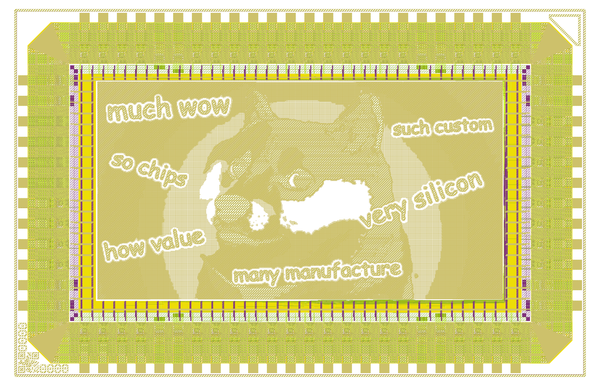

# meme_chip

> much wow · so chips · such custom · very silicon

A meme, rendered as an actual silicon chip layout. This repo contains the
tapeout-ready artifacts for a Doge meme laid out in real fabrication layers —
metal, poly, diffusion, and all — that passes DRC and is ready for
manufacturing.



## What's in here

| Path | Description |
| --- | --- |
| [`chip_top_submission.oas`](chip_top_submission.oas) | The OASIS submission file — the final layout handed off for tapeout. |
| [`gds/chip_top.gds.gz`](gds/chip_top.gds.gz) | The full chip layout in GDSII format (gzipped). |
| [`gds/chip_top.gds`](gds/chip_top.gds) | Uncompressed GDSII layout. |
| [`render/chip_top.png`](render/chip_top.png) | A visual render of the layout — the meme as it appears on silicon. |
| [`precheck_metrics.json`](precheck_metrics.json) | Automated pre-check results (DRC, antenna, density, zero-area polygons). |

## Precheck status

All manufacturing precheck rules pass clean:

| Check | Errors |
| --- | --- |
| KLayout DRC | 0 |
| Magic DRC | 0 |
| Antenna | 0 |
| Density | 0 |
| Zero-area polygons | 0 |

## Viewing the layout

Open the GDS or OASIS file in a layout viewer such as
[KLayout](https://www.klayout.de/):

```sh
# unzip the layout first if needed
gunzip -k gds/chip_top.gds.gz

# then open it
klayout gds/chip_top.gds
# or the submission file
klayout chip_top_submission.oas
```

## Code coming soon

The code that actually generates the layout image — the pipeline that turns a
meme into DRC-clean silicon geometry — isn't quite ready to publish yet. It's
coming soon. For now this repo holds the finished artifacts and the render.

Stay tuned. 🐕

## License

Released under the [MIT License](LICENSE).
